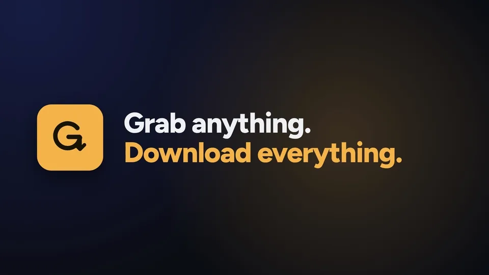
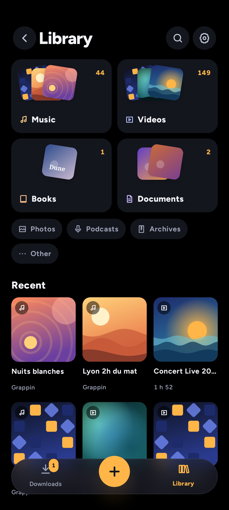
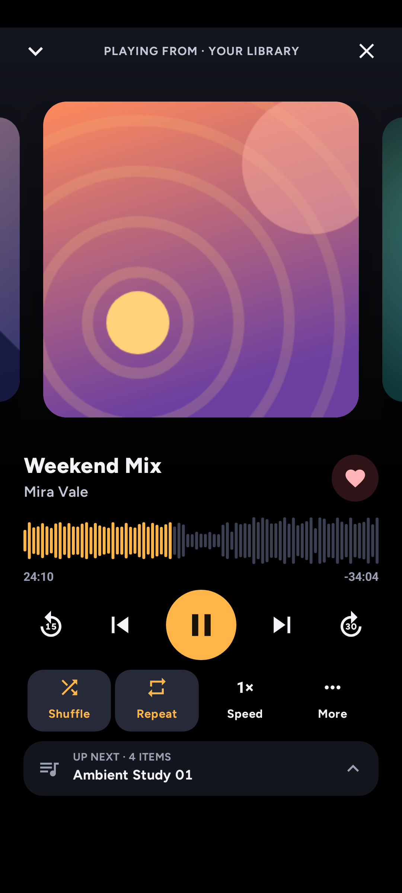
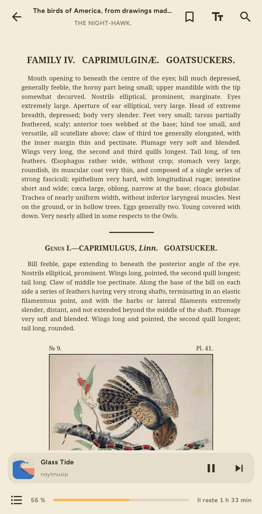
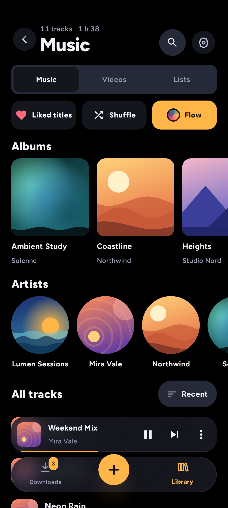
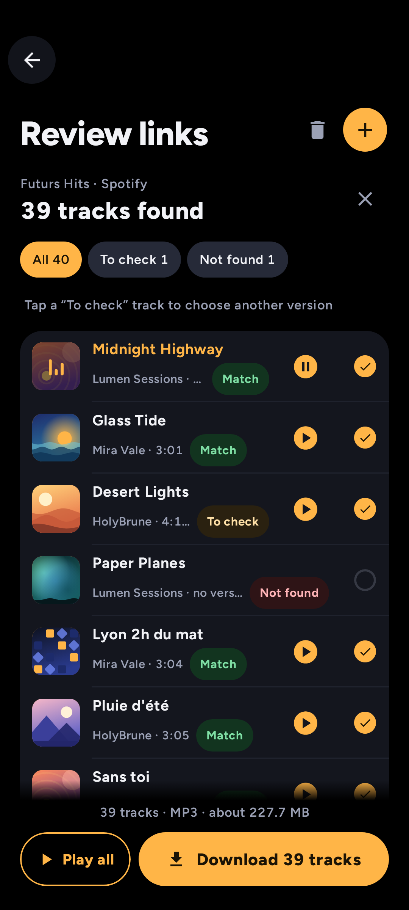
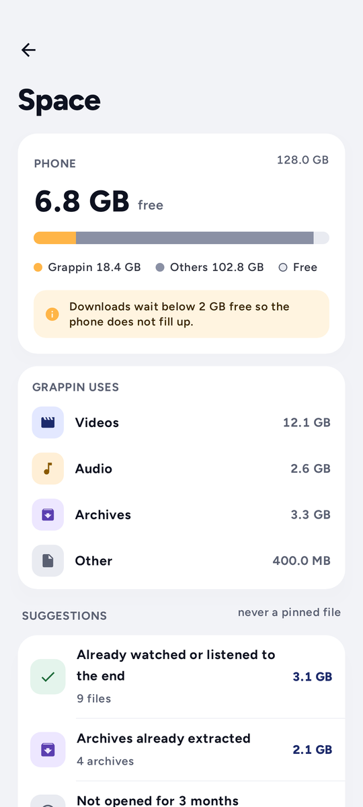

  

<h1 align="center">Grappin</h1>

<b>Grab anything. Play everything.</b> 
Download any file, then watch, listen and read it in one beautiful app.

  
  
  
  
  

  <a href="../../releases"><b>⬇ Download Grappin</b></a>

  

  
  &nbsp;
  
  &nbsp;
  

## Download anything

Paste a link, a page or a playlist: videos, music, books, documents, archives. Grappin finds it, downloads it fast and never fills your phone.

## Play everything

Music, videos, photos, podcasts and books, all in one beautiful player, including what is already on your phone. Start playing in seconds, even before the download ends, sing along with synced lyrics, and turn your photos into a short film to share.

## Discover

The top charts from around the world, live radio and free classic books, one tap from the home screen.

  
  &nbsp;
  
  &nbsp;
  

## Yours, and private

No account, no ads. Your files stay on your phone.

## Get it

1. Download `Grappin-x.y.z.apk` from the [releases page](../../releases) on your phone.
2. Open it. Android asks to **allow installs from this source** (your browser or file manager): turn it on, then go back.
3. If Play Protect shows a warning, tap **More details** then **Install anyway**. Grappin is not on the Play Store yet, so Android simply doesn't know it.
4. Done. Grappin keeps itself up to date from here, no need to come back.

Android 11 or newer.

## Spread the word

Like it? **Star ⭐ the repo** and share the app: in Grappin, *Settings › About › Share Grappin* shows a QR code a friend can scan.

## Get involved

Found a bug, have an idea or want Grappin in your language? [Open an issue](../../issues), every message is read.
Developers who want to contribute can ask for access to the source code there.

English · Français · Español · Português · Português (Brasil) · 中文

---

  Made with care by <b>NiChaN</b> · <a href="https://github.com/Nic69Han">@Nic69Han</a> 
  Thanks for stopping by. Hope Grappin saves you time, enjoy your downloads and your music!

