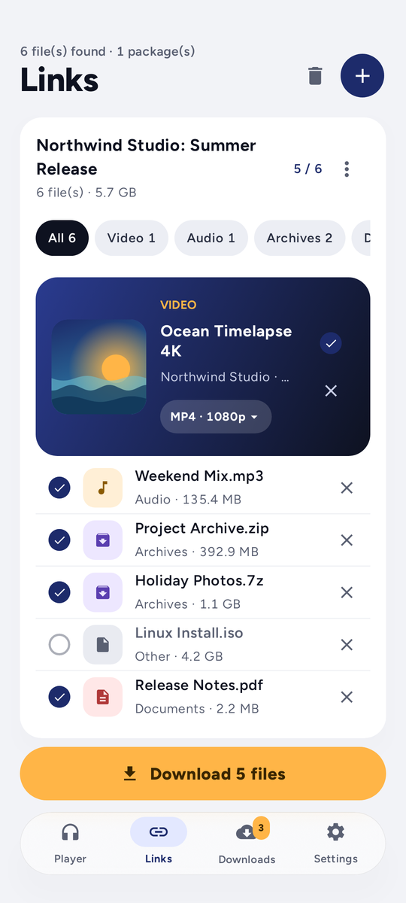
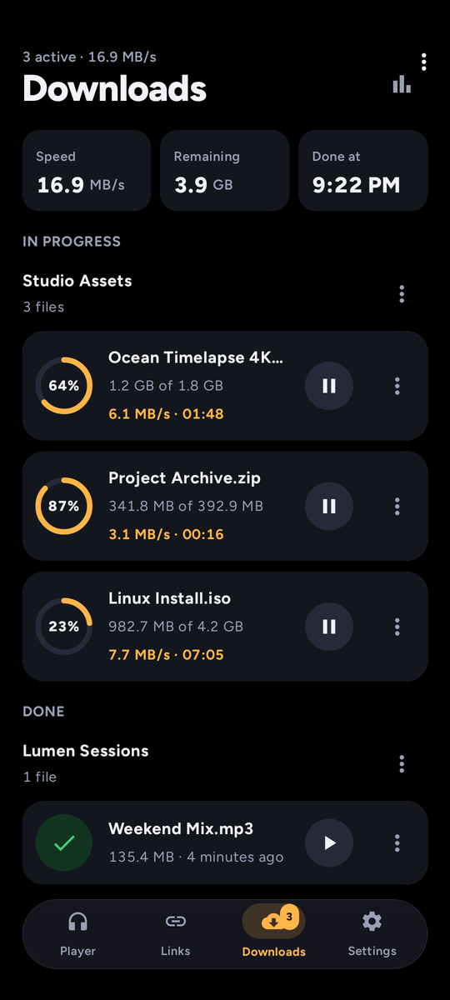
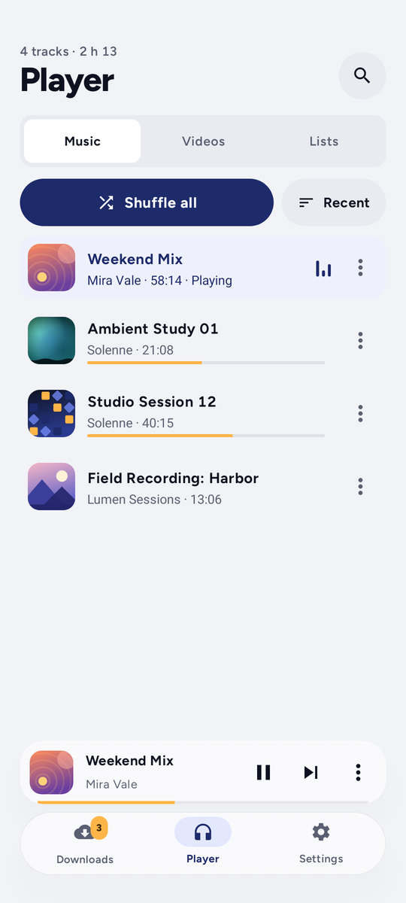
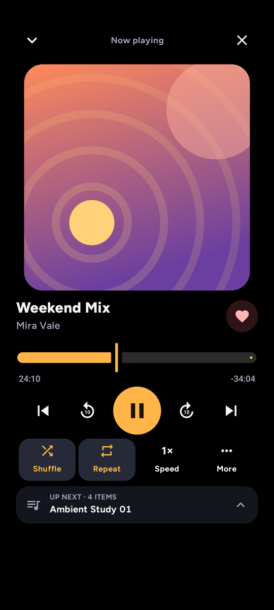
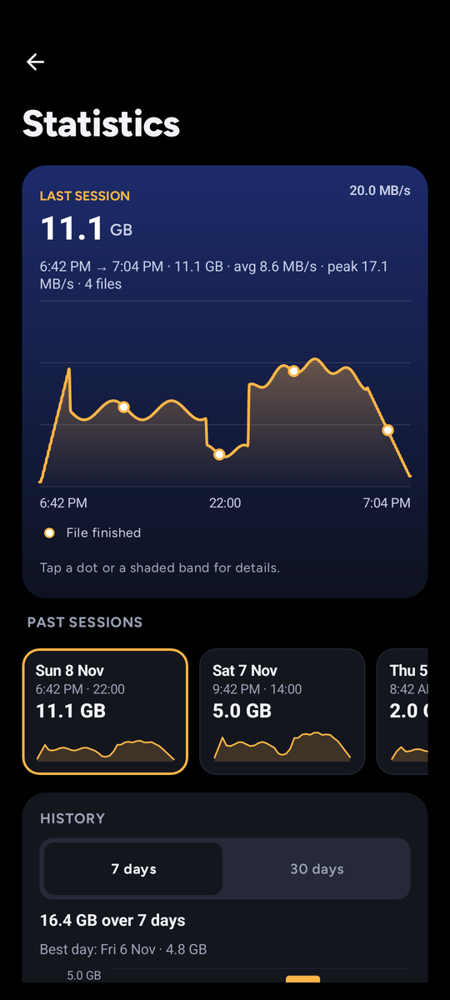
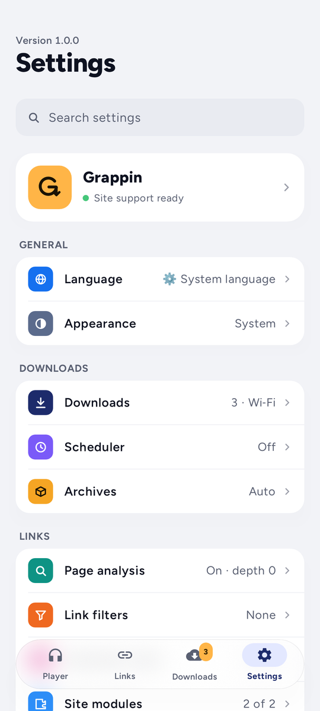

  

<h1 align="center">Grappin</h1>

<b>Grab anything. Download everything.</b> 
The download manager for Android that just works.

  <a href="../../releases"><b>⬇ Download Grappin</b></a>

  
  &nbsp;
  
  &nbsp;
  

## Why Grappin

- **Paste and go.** A link, a whole page or a block of text: Grappin finds every file in it.
- **Fast.** Parallel, multi-part downloads that pick up right where they left off.
- **Video and music.** Save media in the format you want: MP4, MP3, M4A.
- **Built-in player.** Queue, continuous playback, shuffle, equalizer, picture-in-picture.
- **Smart by default.** Duplicate detection, automatic rules, scheduler, Wi-Fi only, speed limit.
- **Never fills your phone.** Downloads wait when space runs low, and a Space page shows what you can safely clear.
- **Archives handled.** ZIP, 7z and RAR unpacked as soon as they land.
- **Your servers too.** FTP, FTPS and SFTP alongside everything else.
- **Made to feel good.** A clean design, a true dark mode, available in 5 languages.

  
  &nbsp;
  
  &nbsp;
  

## Get it

1. Download the APK from the [releases page](../../releases).
2. Open it on your phone and allow the installation.
3. Grappin keeps itself up to date from here.

Android 11 or newer.

English · Français · Español · Português · 中文

