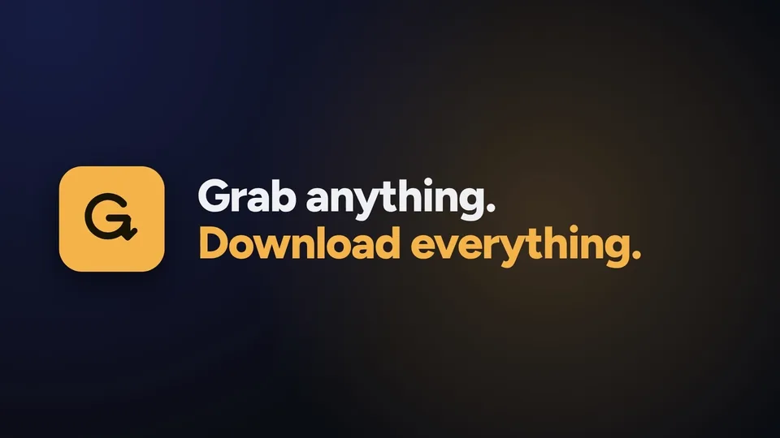
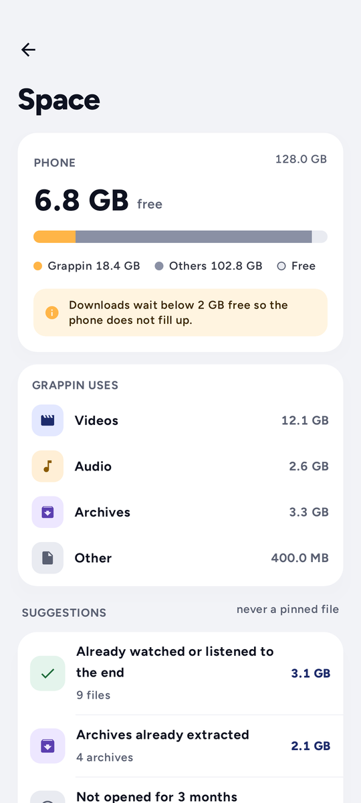
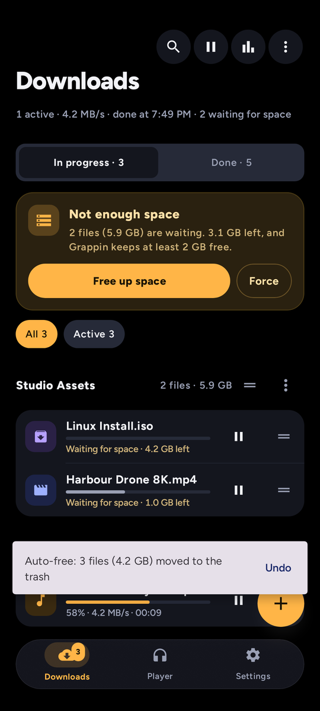

  

<h1 align="center">Grappin</h1>

<b>Grab anything. Download everything.</b> 
The download manager for Android that just works.

  
  
  
  

  <a href="../../releases"><b>⬇ Download Grappin</b></a>

  

  
  &nbsp;
  
  &nbsp;
  

## Why Grappin

- **Paste and go.** A link, a whole page or a block of text: Grappin finds every file in it.
- **Fast.** Parallel, multi-part downloads that pick up right where they left off.
- **Video and music.** Save media in the format you want: MP4, MP3, M4A.
- **Built-in player.** Queue, continuous playback, shuffle, equalizer, picture-in-picture.
- **Smart by default.** Duplicate detection, automatic rules, scheduler, Wi-Fi only, speed limit.
- **Never fills your phone.** Downloads wait when space runs low, and a Space page shows what you can safely clear.
- **Archives handled.** ZIP, 7z and RAR unpacked as soon as they land.
- **Your servers too.** FTP, FTPS and SFTP alongside everything else.
- **Made to feel good.** A clean design, a true dark mode, available in 5 languages.

  
  &nbsp;
  
  &nbsp;
  

## Get it

1. Download `Grappin-x.y.z.apk` from the [releases page](../../releases) on your phone.
2. Open it. Android asks to **allow installs from this source** (your browser or file manager): turn it on, then go back.
3. If Play Protect shows a warning, tap **More details** then **Install anyway**. Grappin is not on the Play Store yet, so Android simply doesn't know it.
4. Done. Grappin keeps itself up to date from here, no need to come back.

Android 11 or newer.

## Spread the word

Like it? **Star ⭐ the repo** and share the app: in Grappin, *Settings › About › Share Grappin* shows a QR code a friend can scan.

## Get involved

Found a bug, have an idea or want Grappin in your language? [Open an issue](../../issues), every message is read.
Developers who want to contribute can ask for access to the source code there.

English · Français · Español · Português · 中文

---

  Made with care by <b>NiChaN</b> · <a href="https://github.com/Nic69Han">@Nic69Han</a> 
  Thanks for stopping by. Hope Grappin saves you time, enjoy your downloads!

